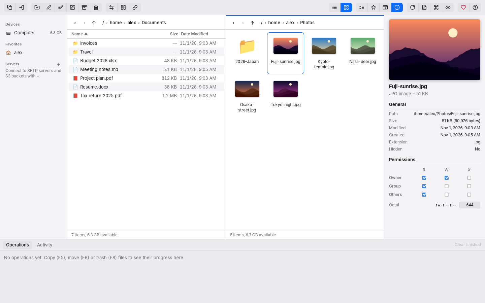
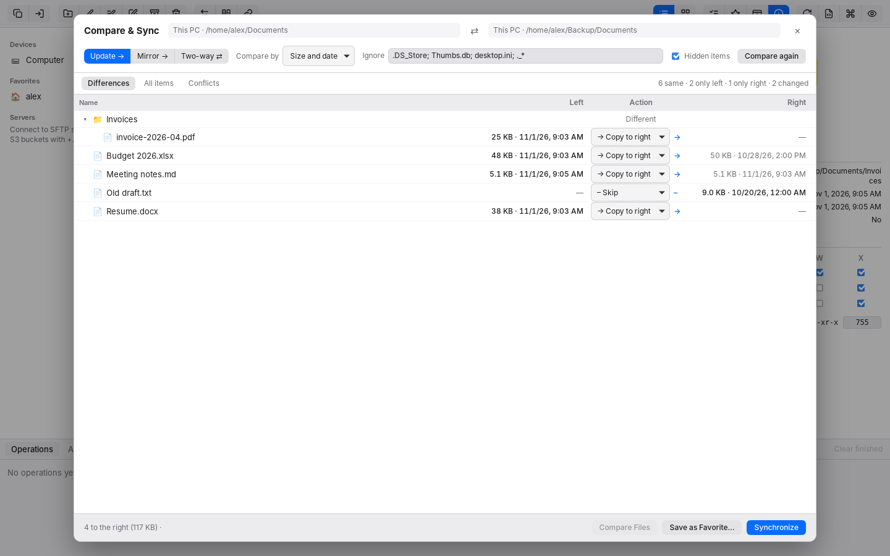

# Dual Pal

A fast, cross-platform dual-pane file manager for **macOS and Windows** (Linux works too), built with [Tauri 2](https://tauri.app): a Rust core and a Svelte web UI.

> Status: early development. All four roadmap steps are in place: two-pane browsing with background operations, SFTP and S3 servers, and folder compare and sync with the power tools below.



<details>
<summary>Compare &amp; Sync</summary>



</details>

## Layout

```
crates/dualpal-core   Platform-independent Rust core (no Tauri dependency)
  src/vfs/            Virtual file system: FileSystem trait, registry, local disk backend
  src/ops/            Operation queue: copy, move, delete, rename, create folder
  src/activity.rs     Persistent activity log (JSON lines) and insights
  src/compare.rs      Folder comparison on any two file systems
  src/sync.rs         One-way and two-way sync with per-pair history
  src/rename.rs       Multi Rename rules and presets
  src/difftools.rs    External file compare apps
src-tauri/            Tauri shell: commands + progress events wiring the core to the UI
ui/                   Svelte 5 + TypeScript front end (built with Vite)
```

### Core concepts

- **`FileSystem`** — every browsable place (local disk, SFTP servers, S3 buckets) implements this async trait. A **`Location`** is `{ fs, path }`, so the UI, the operation queue and the compare/sync engine work the same across local and remote storage. Copies between different file systems stream through the core.
- **`OperationQueue`** — operations run in the background (two at a time by default), report progress (items, bytes, current file) as events, can be cancelled, and clean up partial files. Conflicts are handled per operation: `fail` (default), `skip` or `overwrite`.
- **`ActivityLog`** — every finished operation is recorded and kept across restarts (`activity.jsonl` in the app data folder).

## Development

Prerequisites: [Rust](https://rustup.rs) (stable), Node.js 22, and the [Tauri prerequisites](https://v2.tauri.app/start/prerequisites/) for your OS (Xcode Command Line Tools on macOS; WebView2 + MSVC build tools on Windows).

```sh
npm install
npm run tauri dev        # run the app with hot reload
npm run tauri build      # build an installer (.dmg/.app on macOS, .msi/.exe on Windows)
cargo test --workspace   # core tests
npm run check            # UI type-check
```

## Keyboard

| Key | Action |
| --- | --- |
| Tab | Switch pane |
| ↑ ↓ / Page Up / Page Down / Home / End | Move cursor |
| Enter | Open folder, or open file in its default app |
| Backspace, Ctrl/⌘ ↑ | Enclosing folder |
| Space / Insert | Mark item |
| Ctrl/⌘ A | Mark all |
| F2 | Rename |
| Shift F2 | Multi Rename the marked items |
| F4 | Edit in your preferred editor (files on servers upload again when saved) |
| F5 / F6 | Copy / move to the other pane |
| F7 | New folder |
| F8 / Delete | Move to Trash |
| Shift F8 / Shift Delete | Delete permanently (asks first) |
| + / − | Select / deselect by name pattern (e.g. `*.jpg; *.png`) |
| Ctrl/⌘ 1 / Ctrl/⌘ 2 | List / icon view |
| Ctrl/⌘ T, Ctrl/⌘ W | New tab / close tab |
| Ctrl Tab, Ctrl Shift Tab | Next / previous tab |
| Ctrl/⌘ I | Show / hide the preview and info panel |
| Ctrl/⌘ S (in the editor) | Save the file being quick-edited |
| Ctrl/⌘ R | Refresh |
| Ctrl/⌘ Shift . | Show hidden files |
| Ctrl/⌘ Shift P | Command palette: find any command, server, favorite or sync |
| Ctrl/⌘ Shift Y | Compare & Sync the folders of both panes |
| Ctrl/⌘ Shift D | Compare two files in your compare app |
| Ctrl/⌘ Shift L | Synchronized browsing on / off |

## Servers (SFTP and S3)

Add servers with **+** next to *Servers* in the sidebar.

- **SFTP / SSH** signs in with a password, a private key file (with or without a passphrase), or the running SSH agent plus your default keys in `~/.ssh`. Hosts from `~/.ssh/config` can be picked in the dialog. Host keys are checked against `~/.ssh/known_hosts` like the `ssh` command; a new server asks you to confirm its key fingerprint first, and a changed key is refused.
- **S3** works with Amazon S3 and S3-compatible services (MinIO, Cloudflare R2, Wasabi, Backblaze B2…). Give the bucket, region, access key and, for non-Amazon services, the endpoint URL; most self-hosted services also need *path-style addresses*.
- Passwords, passphrases and secret keys are stored in the macOS Keychain or the Windows Credential Manager, never in Dual Pal's own files.
- Press ★ while browsing a server to add that folder to the server's own favorites, shown under it in the sidebar.
- Copy and move work between any two panes: local ↔ server, server ↔ server.
- **Edit** (F4) or double-click opens a server file in an app; each save is uploaded back. Set the app with **Editor…** in the toolbar. The *Editing* bar shows the files being watched.

Integration tests against real servers (an SSH server, and MinIO or the moto emulator for S3) run when these are set; Linux CI starts both:

```sh
DUALPAL_TEST_SFTP=user@127.0.0.1:2222 DUALPAL_TEST_SFTP_KEY=~/.ssh/test_key \
  DUALPAL_TEST_S3="http://127.0.0.1:9000|bucket|access-key|secret-key" \
  cargo test -p dualpal-core --test remote
```

## Compare, sync and power tools

- **Compare & Sync** compares the folders in the two panes (local or on any server) by size and date, size only, or content. Choose *Update →* (copy new and changed items to the right), *Mirror →* (make the right an exact copy) or *Two-way ⇄*. Every planned step can be changed before you press *Synchronize*, and deletions are confirmed first.
- Two-way sync remembers each folder pair after it syncs, so it can tell a file deleted on one side from a new file on the other, and an edit on one side from an edit on both (a conflict, which is left for you to decide). The first sync of a pair never deletes. Servers that stamp uploads with their own time (S3) do not cause copies back and forth.
- **Save as Favorite** keeps the pair, mode and options under *Syncs* in the sidebar and in the command palette; servers are connected when you open one.
- **Linked** (synchronized browsing): going into a folder, or up, in one pane does the same in the other.
- **Compare Files** opens two files in your compare app (FileMerge, Beyond Compare, Kaleidoscope, VS Code, BBEdit, WinMerge, Meld, P4Merge…, found automatically; choose with *Choose Compare App…* in the command palette). Server files are downloaded first. In Compare & Sync, double-click a changed file.
- **Multi Rename** renames the marked items with rules (replace text or a regular expression, change case, insert text with `{name}` `{ext}` `{parent}` `{date}` `{n}` tokens, numbering, remove characters, change extension) and shows every new name before it renames. Rule sets can be saved as presets; a few come built in. Swapping names between items works.
- **Activity insights** (from the Activity tab or the palette) shows what was done per day, by kind and by place, transfer speed, the largest transfers and recent failures.

## Roadmap

1. **Foundation** — Tauri app, VFS layer, operation queue, activity log. ✅
2. **Dual-pane browser** — tabs, list/icon views, sidebar (devices, favorites), select by pattern or tag, compress, preview panel (audio/video, images, PDF, quick text edit), Move to Trash. ✅
3. **Remote connections** — SFTP over SSH and S3, each with nested favorites; edit remote files in your preferred editor with automatic upload on save. ✅
4. **Compare & power tools** — folder compare and one/two-way sync (saved as favorites), synchronized browsing, external file compare tools, multi-rename presets, command palette, activity insights. ✅

## Installing

Installers for each version are on the [Releases](https://github.com/hoangtuanbs/DualPal/releases) page:

- **Windows** — `Dual.Pal_<version>_x64-setup.exe` (installs for the current user, no admin needed) or `Dual.Pal_<version>_x64_en-US.msi` (for managed installs). SmartScreen may warn about an unknown publisher; choose *More info → Run anyway*.
- **Linux** — `.deb` for Debian and Ubuntu (`sudo apt install ./Dual.Pal_<version>_amd64.deb`), `.rpm` for Fedora and openSUSE (`sudo dnf install ./Dual.Pal-<version>-1.x86_64.rpm`), or the `.AppImage`, which runs on most distributions after `chmod +x`.
- **macOS** — the `.dmg` runs on Apple Silicon and Intel. The app is not notarized yet, so after dragging it to Applications run `xattr -cr "/Applications/Dual Pal.app"` once.

To publish a release, set `version` in `src-tauri/tauri.conf.json` and the root `Cargo.toml`, merge to `main`, then push a matching tag: `git tag v0.2.0 && git push origin v0.2.0`. The **Build installers** workflow builds all platforms and creates the release.

## Test builds

Every push to `main` and every pull request runs the **Build installers** workflow (it can also be started by hand from the Actions tab). Download the installer from the run's **Artifacts** section:

- **macOS** — `DualPal-macOS` contains a `.dmg` that runs on Apple Silicon and Intel. The app is not notarized yet, so after dragging it to Applications run `xattr -cr "/Applications/Dual Pal.app"` once (or right-click → Open) to get past Gatekeeper.
- **Windows** — `DualPal-Windows` contains an `.msi` and a setup `.exe`. SmartScreen may warn about an unknown publisher; choose *More info → Run anyway*.
- **Linux** — `DualPal-Linux` contains an `.AppImage`, a `.deb` and an `.rpm`.

## Help

Click the **?** button at the right end of the toolbar and choose **Email Us…**, or write to [hoangtuanbs@proton.me](mailto:hoangtuanbs@proton.me).
Bugs and ideas are also welcome as [GitHub issues](https://github.com/hoangtuanbs/DualPal/issues).

## Support the project

Dual Pal is free. If it saves you time, you can donate in Ethereum (also in the app with the ♥ button in the toolbar):


`0xF8352b493e7750C03bde4bdA94A203B010933735`

Ethereum (ETH) address. Please double-check the address in your wallet before sending.
